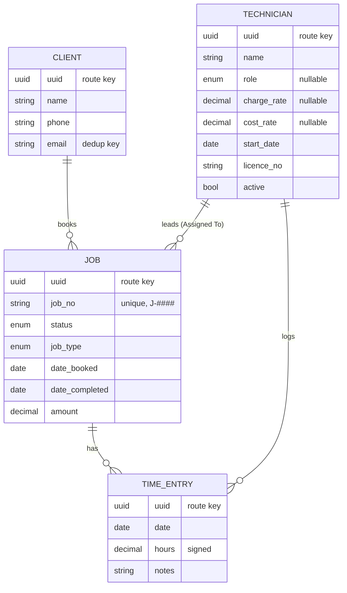

# Data Model

## The real entities

The workbook arrives as three sheets (Jobs, Timesheets, Technicians) kept by three different people, but the sheets don't map 1:1 onto tables. Reading the data (not just the headers) turns up these entities:

- **Client** — not a sheet at all. It's a set of columns repeated on every row of the Jobs sheet (Client, Phone, Email, ...). The same client appears under slightly different names ("Harrow Property Care" vs "Harrow Property Care Pty Ltd"), so a client is really identified by **email**, not by the name string.
- **Technician** — the staff list, but the names used to *refer* to a technician elsewhere in the workbook don't match the staff list's names character-for-character (see below).
- **Role** — the Technicians sheet's `Role` column has only two values across the whole workbook ("Senior Technician", "Technician"), so it's modelled as a PHP backed enum (`App\Enums\TechnicianRole`, cast on `Technician.role`) alongside `JobStatus`/`JobType`, not a separate referenced model. If the business later wants office staff to add new roles without a developer, that's a genuine reason to promote it back to its own table — but two fixed values don't justify the extra join today.
- **Job** — one row per job in the Jobs sheet. `Job No` is the natural key.
- **TimeEntry** — one row per Timesheets entry: a technician, a job, a date, hours, and a note. This is the entity the brief's warning is about.

## The relationship that isn't what the headings imply

`Jobs.Assigned To` reads like "the technician for this job" — a single Job → Technician relationship. It isn't. Cross-referencing against Timesheets shows multiple technicians logging hours against the same job, each with their own date and hour count:

| Job | Assigned To (Jobs sheet) | Timesheets rows |
|---|---|---|
| J-3001 | Danh Nguyen | Danh Nguyen (7.5h, 4.5h) **and** Tom Wallace (4.5h, "Assisting, crane lift") |
| J-3006 | Danh Nguyen | Danh Nguyen (9.5h) **and** J. Fitzsimmons (8.5h, "Refrigeration specialist") |
| J-3010, J-3013, J-3018, J-3022 | (one lead each) | each has a second technician logging hours alongside the lead |

So the real relationship is **many-to-many between Job and Technician, through TimeEntry** (with its own attributes: date, hours, notes). `Assigned To` survives as a single **lead technician** attribute on Job — useful for "whose job is this on the roster," but not a substitute for the timesheet data. A model that used `Assigned To` as the only technician link would silently drop every second-person entry and make "how many hours did each person put in" unanswerable — which is exactly what the brief warned would happen.

## Entities and relationships

- **Client 1—∞ Job**: a client has many jobs (job history).
- **Technician 1—∞ Job** (as *lead*): the `Assigned To` column, kept as `lead_technician_id`.
- **Job 1—∞ TimeEntry**, **Technician 1—∞ TimeEntry**: the real many-to-many, materialised through the join entity.

## Implementation notes

- The `Job` Eloquent model is backed by a table named **`work_orders`**, not `jobs` — Laravel's own queue system already owns a `jobs` table (`database/migrations/0001_01_01_000002_create_jobs_table.php`), and a fresh install ships with it. Reusing that name would either collide or require touching the queue migration, so the domain table is `work_orders` while the class stays `App\Models\Job` (matching the business's own language).
- `hours` on `TimeEntry` is a signed decimal, not an unsigned one — see the correction-entry finding below.
- `JobStatus`, `JobType`, and `TechnicianRole` are PHP backed enums (`app/Enums/`), not free-text columns, so the "outstanding jobs" view and form validation both have a fixed vocabulary to work against.
- All four domain models keep an auto-incrementing integer as the real primary key (fast joins, small indexes, human-readable in the DB/logs) but also carry a unique `uuid` column (v7, time-ordered) that's used as the route key for panel URLs — see `App\Models\Concerns\HasUuid`. `Job::find(1)` and every internal FK/join still use the integer; only what shows up in the browser's address bar (`/admin/jobs/{uuid}`) is the UUID. A guessed or malformed value in the URL 404s cleanly rather than resolving to someone else's record.
  Worth being honest about what this buys here: every authenticated panel user already has full access to every record via the list views (see `NOTES.md` — no per-user policies exist), so ID-guessing isn't currently a path to anything a user couldn't already see by clicking "Jobs" in the nav. The real value is defense-in-depth for later — if row-level authorization is ever added (e.g. a technician who should only see their own jobs), sequential IDs in the URL would have made that trivial to bypass by walking the number line; the UUID route key removes that failure mode from day one without paying the cost of UUID primary keys everywhere (larger indexes, non-sequential inserts, more awkward FK columns). Laravel's own `users` table was left untouched — it's framework/Filament auth scaffolding, not one of the business entities from the workbook, and changing it was out of scope.
